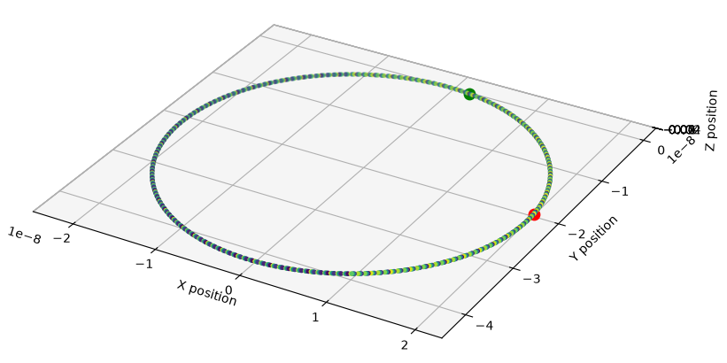

# Accelerator C++

A particle accelerator simulator built from scratch in C++.

## Current Status

### Charged-Particle Motion

Implemented the Boris pusher to simulate a charged particle in a uniform magnetic field (E = 0).

## Next Steps

Extend the simulation to more complex electromagnetic fields, then progress towards charged-particle beam dynamics and accelerator beamline simulations.